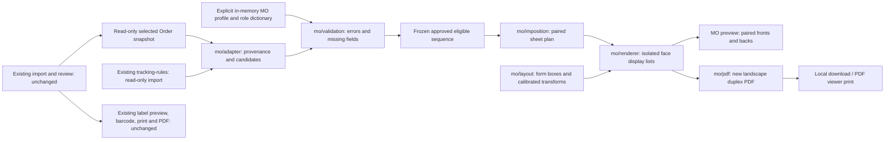
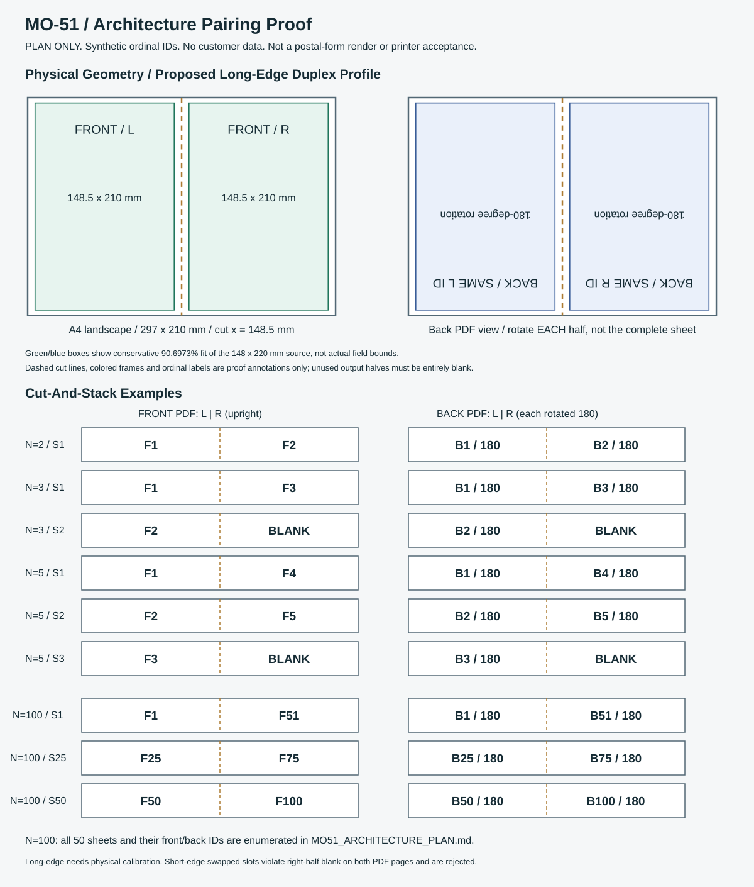

# GFS-LP-042: MO-51 Architecture and Visual Proof

Historical status as of 2026-11-17: PLAN ONLY / NOT APPROVED FOR IMPLEMENTATION OR RELEASE. The later user-authorized LP-048/049 implementation and its current decisions/tests are recorded in `docs/MO51_LP048_DECISIONS.md` and `docs/MO51_LP049_DECISIONS.md`; those records supersede this plan's implementation status and any conflicting proposals below.

Read-only verification window: 2026-11-17, approximately 19:16-19:23 UTC. This document and `MO51_PAIRING_PROOF.svg` are planning artifacts, not application modules. No form renderer, application PDF, deployment, migration, push, staging data submission, or physical print was performed.

Model disclosure: the coordinating session is GPT-6.1. The two read-only reference/data-contract research tasks used available `GPT-5.6 Sol`, `high`, in response to the requested GPT-5.6 High. This is not a claim that the coordinating session changed model.

## A. Inspected Source and Repository Facts

| Check | Fresh evidence | Limit |
| --- | --- | --- |
| Repository root | `D:/free seeds`; project `garden-shop-label-printer/` | The project is a subdirectory, not a separate Git repository. |
| Remote | `https://github.com/gardenshop/freeseeds.git` | Read-only `git remote -v`. |
| Branch | `codex/garden-shop-label-printer-mvp` | No branch switch or worktree creation. |
| Local HEAD | `9034d4df3cbb73fd16fbba26774bb830efea4a86` | LP-041 release documentation commit. |
| Remote branch HEAD | Same SHA, from `git ls-remote --heads` | No fetch, stage, commit, or push. |
| Worktrees | Main checkout plus `D:/Temp/kilo/gfs208-v1` and `D:/Temp/kilo/gfs221-cod-compat` | Other worktrees were not operated. |
| Current protected label source | No working-tree diff in `src/`, `public/`, `index.html`, package files, tests, `RULES.md`, or `README.md` | Existing generated evidence images are dirty and were preserved. |
| Current source vs deployed source | No scoped source/test/Worker/config difference between `8807369` and HEAD | A source comparison does not prove served asset identity. |
| Cloudflare CLI | Project-local Wrangler 4.149.0; OAuth operator `gisupp@gmail.com`; GFS `cb5066a6d71ecdee0bd7ed8aacb4d3c2` | Another account was listed, never selected or queried. CLI identity is not Dashboard identity. |
| Pages inventory | Account-pinned read lists staging project Production/main deployment `13081dbe-5090-4ad5-97bb-7ea5eafd9931`, source `8807369`, first | Dashboard active status and served assets were not freshly inspected. Pages environment name `Production` belongs to the isolated staging project; no production routing was changed. |
| Previous Pages entry | `aae85a83-663d-449f-a20c-52418ed5b5e3`, source `0e64a6f` | Historical LP-041 rollback candidate, not a freshly Dashboard-verified active rollback target. |
| Required records | Parent `rules.md` read in full; project `RULES.md`; `docs/PLAN.md`, `STATUS.md`, `RESOURCE_REGISTRY.md`, `DECISIONS.md`; project README/plan and relevant source | Newer project records take precedence over historical status claims. Parent dirty files were not edited. |
| Reference folder | Exactly `MO 51/VP_Money_Order_Form_A5.html`, 322 lines | No scan, official PDF, measured form, local font, image, or populated customer data. |

### Browser Inspection Boundary

No authorized Chrome DevTools MCP action namespace is exposed to this session, so `list_pages` could not be called. Safe local diagnosis found enabled global `chrome-devtools` configuration, installed official package 1.13.0, two Node processes whose commands match the official bridge, running Chrome, and an existing DevToolsActivePort marker. Endpoint contents, cookies, tokens, tabs, and populated screens were not read. Neither `kilo` nor `codex` is available on the shell PATH. Existing processes were not killed or restarted because ownership cannot be established and restarting does not add tools to this session's schema.

Status is **MCP ACTION EXPOSURE BLOCKED; live bridge initialization/connection NOT VERIFIED**, not a claim that the server has been proven healthy. No raw CDP, shell browser automation, direct Dashboard HTTP, alternate profile, Access bypass, or anonymous staging probe was substituted. No browser tab was opened, reused, navigated, captured, or changed; current tab inventory is unknown. A supported host MCP reconnect/reload and successful `list_pages` are required before browser work. Authentication is then a separate gate, not presumed solved by reconnecting MCP.

### Current Source Anchors

| Source | Relevant contract |
| --- | --- |
| `src/types.ts:1-23,33-53` | `Order`, field aliases, sender defaults; no CNIC/postcodes/MO/date fields. |
| `src/engine.ts:138-188` | Import normalization, `sourceAddress`, warning and duplicate handling. |
| `src/main.ts:168-194` | Current selection/count limit and navigation. Add proposed `MO Print` immediately after `Print & export`, before Monitoring. |
| `src/main.ts:310-336,365-384` | Label blockers and existing print actions. Do not reuse barcode/label-fit blockers as MO validation. |
| `src/main.ts:659-715,810-1074` | Existing label popup and `makePdf()` boundaries; neither may be altered for MO output. |
| `src/tracking-rules.ts:22-33,35-69,79-111` | Classification and exact integer amount/label commission model. Read-only reuse only. |
| `MO 51/VP_Money_Order_Form_A5.html:7-18,218` | External Nastaliq font, 148 x 220 mm artboards, `overflow:hidden`. |

## B. Complete MO Field Mapping

### Roles and Provenance

Use explicit domain roles: `articleSender` (merchant candidate), `articleAddressee` (customer candidate), `moRemitter`, and `moPayee`. The last two roles must not be inferred from parcel FROM/TO. The source's sender/recipient captions do not conclusively distinguish article parties from money-order parties. An approved field-role dictionary is a release prerequisite.

Candidate merchant fields are `Order.senderName` and `senderAddress`. Defaults `Garden Shop` and `C/o City Post Office, Sahiwal` are label copy, not independently verified legal/postal MO identity. Merchant telephone, CNIC and official office information are absent. Candidate customer fields are `name`, `phone`, corrected `address`, `city`, `province`, and optional `landmark`. Preserve `sourceAddress` separately; display any correction for MO review, never overwrite it. Do not append city/province/landmark twice or remove source address details silently.

The following identifiers describe printed positions, not production schema. `B` means source section 1, the probable back; `F` means section 2, the probable front. The HTML itself does not identify sides. Source page 2 has the M.O.-51 title; provisional physical order is therefore F then B, pending authoritative confirmation.

Legend: **A** = available/derived after validation; **C** = conditional on approved semantics/role; **M** = missing explicit operational source; **P** = postal/manual reserved and must remain blank; **U** = meaning unresolved; **T** = fixed template copy, not a data value.

### Probable Back: Source Section 1

| ID | Printed field or area | Proposed source / handling | State | HTML lines |
| --- | --- | --- | --- | --- |
| B01 | Month stamp | Postal stamp; never synthesize. | P | 20-24 |
| B02 | Oblong MO stamp on issue | Reserved issue-stamp area, retain complete boundary. | P | 25-28 |
| B03 | V.P.L. / V.P.P. | Existing classifier selects matching service, not article kind. Preserve the original tracking independently. | A | 31-35 |
| B04 | M.O. No. | Only a genuine assigned MO number if future workflow permits; otherwise blank. Never tracking, FS reference, row number, or counter. | P/M | 36-40 |
| B05 | MO date | Genuine MO issue date, distinct from import/current/print date; blank now. | P/M | 39-41 |
| B06 | For / Rs. | Candidate validated `declaredAmount` from `Order.cod`, excluding label commission; semantic sign-off required. | A/C | 44-47 |
| B07 | No. of V.P. Article | Candidate exact `Order.tracking`, not normalized tracking. Confirm that No. means identifier, not count. | A/C | 48-51 |
| B08 | Amount in words | Deterministic wording of the same approved integer as B06, never a second amount source. Language/convention needs approval. | A/C | 52-55 |
| B09 | Letter / parcel | Explicit article-kind supplement; VPL/VPP prefix is not proof of letter/parcel/packet. Packet is absent from this selector. | M/U | 69-73 |
| B10 | Remittance rupees / paisa | Same approved principal as B06. Whole-rupee source mathematically has zero paisa; show `00` only under approved formatting, not as a guessed amount. | A/C | 76-81 |
| B11 | Remittance in words / only | Same canonical wording as B08. | A/C | 83-87 |
| B12 | Sender name | Candidate `articleSender.name` from reviewed `senderName`, but field-to-role assignment remains blocked. | C | 89-103 |
| B13 | Sender full address | Candidate reviewed `senderAddress`; not a verified paying/issuing office. | C | 89-103 |
| B14 | Sender telephone | Explicit source for the party approved for B12; no merchant phone exists in current import contract. | M/C | 89-103 |
| B15 | Sender CNIC | Explicit authentic party identity only; no source and no derivation. | M/C | 89-103 |
| B16 | Relationship / connection | Explicit reviewed declaration; related party is unclear. Never infer from a purchase. | M/U | 89-103 |
| B17 | Source of income | Explicit declaration only, never product/order inference. | M | 89-103 |
| B18 | Reason for remittance | Explicit approved declaration only; do not automatically assert a sale or written demand. | M | 89-103 |
| B19 | Unlabelled six cells after sender | Meaning absent. Keep blank; do not label as postcode or pad to six digits. | U | 106-115 |
| B20 | Recipient name | Candidate customer `name` only if field means article addressee; if MO payee, candidate is reviewed merchant. No automatic role choice. | C/U | 117-131 |
| B21 | Recipient full address | Address for the approved B20 role; customer `address`/city/province available, merchant profile partial. | C | 117-131 |
| B22 | Recipient telephone | Customer `phone` available only if B20 is article addressee; merchant phone absent otherwise. | A/C | 117-131 |
| B23 | Recipient CNIC | Authentic identity of approved B20 party; absent. | M/C | 117-131 |
| B24 | Recipient relationship | Explicit declaration, not inferred from sender/customer roles. | M/U | 117-131 |
| B25 | Unlabelled six cells after recipient | Meaning absent; keep blank, not an assumed postcode. | U | 134-143 |
| B26 | Declaration date | Explicit actual declaration date if permitted; never import/print date by default. | M/C | 145-150 |
| B27 | Sender signature | Real handwritten signature only; retain blank area. | P | 145-150 |
| B28 | Intimation rupees / paisa | Same approved canonical principal as B06/B10, not commission/total. | A/C | 159-164 |
| B29 | For / issuing office name | Explicit verified issuing-office information; customer city and label sender address are not office evidence. Placement needs confirmation. | M/U | 165-180 |
| B30 | Issuing-office postcode, six cells | Explicit verified office postcode; retain leading zeroes if present. Do not force six digits. Format mismatch blocks population. | M/U | 169-180 |
| B31 | VP article kind | Same explicit kind as B09; footnote includes letter, packet, parcel. Resolve selector disagreement before use. | M/U | 181-186,211 |
| B32 | Article/intimation date | Explicit date for this operation only, distinct from B05/B26/F03/payment dates. | M/C | 181-186 |
| B33 | Article/item number | Candidate same exact tracking as B07 after identifier semantics confirmed. | A/C | 187-190 |
| B34 | In the name of / addressed to | Explicit role mapping; candidate article addressee, not automatically B20 or merchant payee. | C/U | 191-194 |
| B35 | Destination postcode, six cells | Authentic destination postcode for B34; absent, never inferred from city/province. | M/U | 195-205 |
| B36 | Date stamp of office of issue | Real postal date stamp only; preserve circle. | P | 207-210 |

B12-B18 share four ruled lines; B20-B24 also share four. Use one measured composite block per party, not independent overlays competing for the same lines. Missing required content must block completed output rather than be hidden in a clipped line.

### Probable Front: Source Section 2

| ID | Printed field or area | Proposed source / handling | State | HTML lines |
| --- | --- | --- | --- | --- |
| F01 | Paying post-office name | Explicit verified paying office; not inferred from sender address. | M/C | 249-253 |
| F02 | Office where VP article is delivered | Explicit verified delivery-office mapping; city/province alone insufficient. | M/C | 254-258 |
| F03 | VP journal entry date | Postal journal operation; leave blank. | P | 261-264 |
| F04 | Witness signature / two rules | Actual witness handwriting; do not invent witness identity or assume second line meaning. | P/U | 266-275 |
| F05 | Registration/parcel clerk initials | Reserved clerk action; apparent transcription defect in caption must not be silently corrected. | P | 277-280 |
| F06 | Received amount written on other side | Fixed acknowledgement copy; printing it never proves receipt/payment. | T | 279-280 |
| F07 | Thumb impression | Actual human impression only; blank area. | P | 281-284 |
| F08 | VP sender/payee signature in ink | Handwritten; exact caption/party needs confirmation, never a digital signature invention. | P/U | 285-286 |
| F09 | I paid | Fixed declaration text, not an application payment state. | T | 285-288 |
| F10 | Official signature, date, designation | Real postal official completes shared line. | P | 287-289 |
| F11 | Round MO stamp authorising payment | Reserved real stamp; do not draw stamp content. | P | 292-303 |
| F12 | Oblong MO stamp on payment | Reserved real stamp; preserve space. | P | 304-305 |

Other fixed content is also protected: sender certification B lines 63-68, INTIMATION heading, article-kind footnote, `M.O.-51 (Revised)` without revision date, CSS-drawn Pakistan Post mark, Pakistan Money Order/Value Payable/Postmaster headings, authorisation instructions and Rs. 1,000 threshold (293-299), fold line (308-312), fifty-paisa price/commission imprint (314), and press credit (317). These are reference text, not validated current postal law/tariff. Do not turn the fifty-paisa imprint into a calculated fee or silently modernize Urdu. Source authenticity/current validity is unverified.

### All Existing Import Fields Accounted For

`tracking` supplies the candidate article identifier; `cod` supplies the validated candidate principal; `name`, `phone`, `address`, `city`, `province`, `landmark`, `senderName`, and `senderAddress` supply conditional party data. `sourceAddress` is provenance/review only. `rowNumber`, `serial`, `orderId`, and `printedReference` are local provenance/selection identifiers, not MO numbers; do not reserve a new FS reference. `email`, `facebookName`, and `product` have no matching MO blank and are not printed or mined for missing identity, article kind, reason, or money. `warnings` are input signals; do not mutate them or treat label geometry errors as MO legal errors.

### Declared Value and Commission

Verified current source semantics: VPL/VPP `cod` is labelled Declared Amount; valid values are whole rupees 1 through 100,000. Classification removes whitespace/uppercases a derived string only. `Order.tracking` and `cod` retain their current imported strings; these strings are already stringified/trimmed by import, so do not claim byte-exact recovery of the original workbook cell. Only `sourceAddress` has a separate original-address field.

Label-only commission is `min(500, floor(A/20000)*100 + remainderFee)`, with remainderFee 0 for zero remainder, 75 for a remainder below 10,000, otherwise 100. It is not proof of Pakistan Post's applicable MO tariff and cannot change the principal or any payment/COD state.

Proposed MO mapping is principal A, not A+C, subject to postal-field semantic approval. Synthetic example: A=45,000; label commission C=275; existing label remains `45000+275`; candidate MO figure/words represent 45,000, never 45,275. All repeated amount fields bind to that one value. Missing/invalid A blocks output; no fallback, subtraction, guessed commission, or cap. Deterministic amount-in-words generation is permitted only from a valid known A and must be tested against that same integer.

## C. Isolated Architecture

Proposed files only; none are created in this planning stage:

| Module | Owns | Must not own |
| --- | --- | --- |
| `src/mo/adapter.ts` | Readonly copies of selected `{row,index}`, source strings and role candidates; call `classifyTrackingPrefix`, `normalizeTrackingReference`, `calculateCommission` read-only | Import parsing, `Order` changes, defaults that fabricate MO identity, IndexedDB reference writes |
| `src/mo/validation.ts` | MO-specific requiredness, role/profile status, duplicate checks, principal/words agreement, precise exclusion reasons | Existing label `printBlocker`, barcode density, label content fitting, payment approval |
| `src/mo/layout.ts` | Versioned master geometry, face identity, immutable mm field boxes, safe profile and front/back transforms | `src/layout.ts`, label CSS/presets, global CSS rules |
| `src/mo/renderer.ts` | Both faces from shared display lists; full Urdu shaping, local font readiness, bounds/line checks; escape text, explicitly isolate LTR identifiers | Executing imported/template scripts, HTML injection, external font fetches, clipping or further auto-shrink |
| `src/mo/imposition.ts` | Pure `N -> S -> sheet front/back slots`, null slots, stable identity, face order and per-half rotation | Selection mutation, reordering labels, late filtering, money/identity defaults |
| `src/mo/pdf.ts` | New `pdf-lib` document, 297 x 210 mm pages, paired page order, vector rules/stamp outlines, locally shaped text, download cleanup | Existing `makePdf`, existing barcode/PDF logic, existing label monitoring events |
| `src/mo/view.ts` and scoped styles | Separate `MO Print` navigation/view after Print & export; eligibility summary, missing fields, read-only source review, duplex profile, paired preview | Editing label data behind the user's back, calling Admin/API/audit, registering global `@page` affecting label print |

The only later host changes should be minimal view-union/navigation/render/handler wiring in `src/main.ts` plus an MO-scoped lazy import. Preserve all existing actions and handlers. Default closed/disabled entry until approved template/profile is available; failures stay within the MO view. No Worker, D1, Access, Admin, API, COD, payment, Meta, WhatsApp, route, or package upgrade is necessary.

Output design: use one MO display list in mm for preview and PDF. Render rules and outlines as vectors with `pdf-lib`; shape Urdu/mixed-script lines using the same loaded local font in the browser and embed bounded high-resolution text strips when standard PDF fonts cannot shape them. Do not assume existing standard PDF fonts can encode Urdu. Work one face/form at a time, release raster buffers/object URLs, and apply a tested memory ceiling for the 102-page case. Do not retain 100 full A4 600-dpi canvases. Lossless glyph-strip encoding and effective resolution of at least 300 dpi are proposed, subject to visual proof. A browser-only Save-as-PDF popup is not a substitute for the requested app PDF module.

The source uses Noto Nastaliq Urdu; the existing app dependency is Noto Naskh Arabic. These fonts are not metric-equivalent. An approved locally bundled Nastaliq font or an explicitly approved reflow/font substitution is required; no CDN request. Adding a dependency/font later requires license/size/security review, not an unapproved install now.

### Selection and Isolation Rules

Snapshot the current selection and existing count-limit result once, then retain original import row order among those chosen (do not depend on Set click order). A view filter/search must not silently redefine selection. Show selected count, count-limited count, VPL/VPP candidate count, eligible count, and exclusions by reason. Eligible N means selected, supported VPL/VPP, unique tracking, valid principal, verified required role/profile data, and MO-fit PASS; it is not total imported row count.

Read-only reuse of current normalized data is required, but label-only missing product/printed-reference/barcode-fit warnings must not reject an otherwise valid MO. MO data/role errors do reject it. RGL/UMS always appear as excluded from MO, with their original rows, selection and labels unchanged; unknown prefixes are errors, never assumed VPL. If one member of a normalized-tracking duplicate group is selected, still flag collisions against the whole imported batch rather than quietly choosing a winner.

An incomplete preview may be clearly watermarked DRAFT / INCOMPLETE, with missing fields visible in the UI. A completed-form export stays disabled until the approved required-field policy passes; postal/manual-reserved blanks are not missing application data. If an official prefill-with-manual-completion workflow is desired, approve it explicitly with an exact blank-field allowlist. Current imports alone are not proof that official MO forms are complete.

Capture a source revision and selection fingerprint in memory when preview is approved. Label edits/import/selection/profile changes invalidate the MO preview; revalidate and explicitly regenerate N and S. After freeze, any fit/font/render/cancellation failure aborts the entire export, not a record or page, so no front/back pairing shifts. Never log the fingerprint's raw customer inputs. No new profile/CNIC persistence, telemetry, localStorage/IndexedDB schema, remote font, or monitoring event is part of this phase. Closing/resetting MO clears supplements and revokes object URLs.

## D. Geometry and Visual Proofs

### Non-Cropping Fit

A4 landscape is exactly 297 x 210 mm. Left form area is x=[0,148.5], y=[0,210]; right is x=[148.5,297], y=[0,210]. There is no gutter or sheet-size change. Cut at x=148.5. PDF MediaBox is approximately 841.8898 x 595.2756 pt, preferably with `/Rotate=0` and explicit transforms.

Reference master is 148 x 220 mm, with `box-sizing:border-box`, pixel-based internal geometry and `overflow:hidden` on both sides. Reducing only the CSS height would crop content. Filling target width would produce approximately 220.743 mm height. Nonuniform scaling would distort Urdu, handwriting areas and stamp circles. Neither is acceptable.

Uniform artboard fit:

`s = min((148.5 - 2m)/148, (210 - 2m)/220)`

`x = (148.5 - 148s)/2`, `y = (210 - 220s)/2` within each half.

| Profile | Scale | Resulting artboard | Half-relative x/y |
| --- | --- | --- | --- |
| Geometric only, m=0 | 95.4545% | 141.2727 x 210 mm | 3.6136 / 0 mm |
| Conservative proposal, m=5.233 mm | 90.6973% | 134.23196 x 199.534 mm | 7.13402 / 5.233 mm |

The 5.233 mm value comes from historical custom-label HP evidence, NOT a fresh A4 duplex imageable-area measurement. It is a conservative design candidate on every half edge, including the cut, not a claim that A4 duplex hardware has these margins. Use the maximum measured safe envelope of both sides, plus allowance, for the final single shared scale. Calibration offsets must never move required content outside that envelope.

Before transforming, temporarily expose all overflow in an isolated reference measurement, wait for fonts, and measure ink bounds as well as boxes on both full 148 x 220 masters. Every caption, Urdu ascender/descender, rule, stamp, witness and signature area must fit the measured master. If the original already clips, uniform scaling cannot restore missing content; stop and repair the isolated template under approval, without changing the uploaded reference.

Readability remains a blocker: source 8 px becomes about 5.73 pt at 95.4545%, or 5.44 pt at the conservative scale. Source 9.5 px Urdu becomes about 6.80/6.46 pt. Four identity writing lines of 19 px become only about 4.78/4.56 mm high. A source 54 px round stamp becomes about 13.00 mm diameter at the conservative scale, and the 230 x 44 px payment-stamp box about 55.19 x 10.56 mm before border. These areas must be compared against actual stamps/handwriting needs, not just shown inside the page.

Therefore the fit specification is: preserve full artboard uniformly, prohibit cropping and additional text shrink, verify readable local Urdu and physical stamp/signature room, then approve either this scale or a source-faithful reflow within the same 148.5 x 210 mm form area. Reflow may recover excessive gaps/margins, but cannot remove legal copy, fields, fold line, stamps, signatures or press credit. Stamp sizes and minimum readable type require actual reference acceptance. No numeric minimum is represented as a Pakistan Post rule.

### Proof Scope

This is a static ordinal-only design proof. It does not render the actual Urdu form, prove font shaping/no clipping, constitute a generated MO PDF, or establish physical duplex alignment. Colored frames, dashed cuts, B/F IDs and rotation captions are diagnostic annotations only, not production marks. Actual populated synthetic front/back renders remain BLOCKED on approved semantics/font/template and the authorized browser inspection path.

`Fk` and `Bk` mean the paired front/back of eligible record k, not source row k. `Bk^180` denotes rotating that individual back form 180 degrees in its own slot. A dash is a completely unpainted half: no frame, watermark, page number, cut mark, placeholder or hidden field. Preview-only boundaries do not appear in export.

### All Sheets for N=2, N=3 and N=5

| N | S | Sheet | PDF pages | Front L / R | Back L / R, proposed long-edge profile |
| --- | --- | --- | --- | --- | --- |
| 2 | 1 | 1 | 1 / 2 | F1 / F2 | B1^180 / B2^180 |
| 3 | 2 | 1 | 1 / 2 | F1 / F3 | B1^180 / B3^180 |
| 3 | 2 | 2 | 3 / 4 | F2 / - | B2^180 / - |
| 5 | 3 | 1 | 1 / 2 | F1 / F4 | B1^180 / B4^180 |
| 5 | 3 | 2 | 3 / 4 | F2 / F5 | B2^180 / B5^180 |
| 5 | 3 | 3 | 5 / 6 | F3 / - | B3^180 / - |

### Exhaustive N=100 Imposition

S=50, 50 physical sheets, 100 PDF pages. Every listed back pair has each form rotated 180 degrees, not the whole sheet. No implicit omitted sheets:

| Sheet | PDF front/back pages | Front L/R | Back L/R |
| --- | --- | --- | --- |
| 1 | 1/2 | F1/F51 | B1/B51 |
| 2 | 3/4 | F2/F52 | B2/B52 |
| 3 | 5/6 | F3/F53 | B3/B53 |
| 4 | 7/8 | F4/F54 | B4/B54 |
| 5 | 9/10 | F5/F55 | B5/B55 |
| 6 | 11/12 | F6/F56 | B6/B56 |
| 7 | 13/14 | F7/F57 | B7/B57 |
| 8 | 15/16 | F8/F58 | B8/B58 |
| 9 | 17/18 | F9/F59 | B9/B59 |
| 10 | 19/20 | F10/F60 | B10/B60 |
| 11 | 21/22 | F11/F61 | B11/B61 |
| 12 | 23/24 | F12/F62 | B12/B62 |
| 13 | 25/26 | F13/F63 | B13/B63 |
| 14 | 27/28 | F14/F64 | B14/B64 |
| 15 | 29/30 | F15/F65 | B15/B65 |
| 16 | 31/32 | F16/F66 | B16/B66 |
| 17 | 33/34 | F17/F67 | B17/B67 |
| 18 | 35/36 | F18/F68 | B18/B68 |
| 19 | 37/38 | F19/F69 | B19/B69 |
| 20 | 39/40 | F20/F70 | B20/B70 |
| 21 | 41/42 | F21/F71 | B21/B71 |
| 22 | 43/44 | F22/F72 | B22/B72 |
| 23 | 45/46 | F23/F73 | B23/B73 |
| 24 | 47/48 | F24/F74 | B24/B74 |
| 25 | 49/50 | F25/F75 | B25/B75 |
| 26 | 51/52 | F26/F76 | B26/B76 |
| 27 | 53/54 | F27/F77 | B27/B77 |
| 28 | 55/56 | F28/F78 | B28/B78 |
| 29 | 57/58 | F29/F79 | B29/B79 |
| 30 | 59/60 | F30/F80 | B30/B80 |
| 31 | 61/62 | F31/F81 | B31/B81 |
| 32 | 63/64 | F32/F82 | B32/B82 |
| 33 | 65/66 | F33/F83 | B33/B83 |
| 34 | 67/68 | F34/F84 | B34/B84 |
| 35 | 69/70 | F35/F85 | B35/B85 |
| 36 | 71/72 | F36/F86 | B36/B86 |
| 37 | 73/74 | F37/F87 | B37/B87 |
| 38 | 75/76 | F38/F88 | B38/B88 |
| 39 | 77/78 | F39/F89 | B39/B89 |
| 40 | 79/80 | F40/F90 | B40/B90 |
| 41 | 81/82 | F41/F91 | B41/B91 |
| 42 | 83/84 | F42/F92 | B42/B92 |
| 43 | 85/86 | F43/F93 | B43/B93 |
| 44 | 87/88 | F44/F94 | B44/B94 |
| 45 | 89/90 | F45/F95 | B45/B95 |
| 46 | 91/92 | F46/F96 | B46/B96 |
| 47 | 93/94 | F47/F97 | B47/B97 |
| 48 | 95/96 | F48/F98 | B48/B98 |
| 49 | 97/98 | F49/F99 | B49/B99 |
| 50 | 99/100 | F50/F100 | B50/B100 |

For all N, sheet i has L=i and R=i+ceil(N/2) if available. Emit F(sheet i), B(sheet i) consecutively, not all fronts then all backs. Preserve a blank right half on both pages for the final odd sheet. Never suppress a physical back page, even when much of the completed form is intentionally blank.

Cut-and-stack handling: restore printed sheet order 1..S front-up before cutting, keep both resulting piles in that order, place the left pile above the right pile, remove only the final blank piece, and obtain 1..N. Test actual face-up/face-down tray collation; do not reverse record order to compensate silently. Manual duplex refeed order is a separate calibrated profile, not inferred from automatic duplex settings.

## E. Duplex and Physical Printer Specification

### Proposed Coordinate Convention

Sheet origin is top-left when viewing each PDF page upright. A4 is landscape. Each finished form is portrait, 148.5 x 210 mm. Desired handling after cutting is turning a finished form over about its 210 mm edge with matching top direction on both faces.

| Profile | Back page slot IDs | Back artwork rotation | Odd final blank | Approval |
| --- | --- | --- | --- | --- |
| Landscape long-edge, same-slot | Same L/R as front | 180 degrees inside EACH half | Right on both PDF pages | Proposed canonical design; hardware calibration required. |
| Landscape short-edge, swapped-slot | R/L relative to front | Upright | Right on front, LEFT in back PDF coordinates | NONCOMPLIANT with the approved right-half-blank-on-both-pages rule. Rejected/disabled in this scope, even though the same physical piece stays blank. |
| Manual two-pass duplex | Measured refeed profile only | Determined by marked-sheet test | Must satisfy approved physical/page convention | Disabled until feed face, edge and stack direction are recorded. |

Long-edge vs short-edge refer to landscape sheet edges, not portrait-form edges. Driver auto-rotation, reverse landscape and PDF viewer handling can change results; the table is an explicit proposed convention, not verified device behavior. Do not mirror text or use a whole-sheet 180-degree rotation as a substitute for per-half rotation: whole-sheet rotation swaps the slots.

For half-relative point (x,y), the long-edge back transform is `(148.5-x, 210-y)` plus that half's x origin; rotate about the half centre (74.25,105). Apply shared scale/placement first, then per-half rotation, then measured sheet-coordinate calibration offsets. Rotation and blank-slot rules are independent of which source section is approved as the front.

### Calibration Procedure and Gates

1. Read current intended printer model, driver version, supported A4 duplex imageable bounds, tray and viewer settings without changing system defaults. Historical P2055dn custom-paper margins and Letter/Simplex defaults are not current A4 duplex proof.
2. Create a later dedicated synthetic calibration PDF, not a production form: A4 landscape, L/R and face IDs, TOP arrow, four edge fiducials, centre-cut reference, 100 mm ruler, and asymmetric corners on both sides. No real personal data or genuine postal identifiers.
3. Print one plain-paper two-record sheet at Actual Size/100%, A4 landscape in both viewer/driver, Fit/Shrink/Booklet/Multiple-pages off, exactly one PDF page per paper side, headers/footers off. Select the proposed long-edge setting; do not apply a second viewer two-up imposition.
4. Inspect through light and after turning/cutting. F1 must be behind B1, F2 behind B2, no mirror text, and tops align for the intended finished-form turn. Reject wrong-face order/slot or 180-degree inversions; correct the explicit profile, not the data.
5. Measure each side's four edge offsets, 100 mm line, centre cut at 148.5 mm, rotation/skew and front/back registration at both halves. Proposed engineering tolerances: 100 mm line within 0.5 mm, cut position within 0.5 mm, front/back registration within 1 mm at all fiducials, no required ink in non-imageable bounds. These are proposed operational tolerances, not postal specifications; physical stamp/writing fit may require stricter limits.
6. Store only an approved non-personal calibration profile keyed by printer/driver/viewer/paper/duplex convention in future implementation, with bounded dx/dy, measured safe envelope, time and evidence. Keep supplements/customer fields out of it. Clamp nothing silently; out-of-envelope offsets reject the profile.
7. Reprint the same sheet and remeasure after any correction. Test an N=3 two-sheet batch, verify final right half is unpainted on both PDF pages and the physical blank has no printing on either side. Cut/stack and verify 1,2,3. Then test a five-record job and actual paper/stamp/signature clearance before operational stock. Recalibrate after driver, viewer, tray or paper change.

Automation should generate/inspect synthetic proofs and arithmetic without owner work. Physical paper measurement and Access authentication are genuine hardware/security boundaries; no manual data re-entry or real customer sample is required. No physical test was attempted in this planning stage.

## F. Tests and Zero-Regression Safeguards

### Count Matrix

Back IDs match front IDs in the proposed canonical profile, with each back rotated 180 degrees. PDF pages are exactly 2S.

| Eligible N | Sheets S | PDF pages | First L/R | Last L/R | Blank right halves per side |
| --- | --- | --- | --- | --- | --- |
| 0 | 0 | 0 | - | - | No empty PDF; export disabled. |
| 1 | 1 | 2 | 1/- | 1/- | 1 |
| 2 | 1 | 2 | 1/2 | 1/2 | 0 |
| 3 | 2 | 4 | 1/3 | 2/- | 1 |
| 5 | 3 | 6 | 1/4 | 3/- | 1 |
| 50 | 25 | 50 | 1/26 | 25/50 | 0 |
| 99 | 50 | 100 | 1/51 | 50/- | 1 |
| 100 | 50 | 100 | 1/51 | 50/100 | 0 |
| 101 | 51 | 102 | 1/52 | 51/- | 1 |

### Additional Test Matrix

| Area | Required assertions |
| --- | --- |
| Mixed prefixes | Ordered synthetic batch RGL, VPL, UMS, VPP, unknown, whitespace/lowercase VPL, invalid-amount VPP: only the three valid VPL/VPP rows are candidates; assuming required supplements pass, N=3 with 1/3 and 2/blank. Exclusions are visible, original seven rows/selection/source tracking stay unchanged. |
| Prefix/amount reuse | Existing centralized parsing/commission tests unchanged; test all current amount boundaries 5,000 through 100,000 plus malformed commas, decimal, zero, negative, missing and 100,001 rejection. MO amounts never include commission. |
| Preservation | Deep-freeze inputs, supplements and selection. Compare before/after strings, raw address, amount, tracking, row identity and label outputs; MO must not reserve/replace printed references. |
| Role/requiredness | No default legal merchant verification; no CNIC/date/postcode/MO-number guessing; unknown roles/box meanings block affected population; explicitly reserved fields remain blank. No lookup/network path. |
| Identity duplicates | Case/whitespace duplicate tracking, including an unselected colliding row; duplicate groups fail closed without choosing a winner. Missing source Order ID alone is not a fabricated MO number. |
| Imposition properties | For all required N and broader generated counts, every eligible identity occurs once per face, no cross-record pairing, stable sheet/page ordering, null-slot parity, cut-and-stack gives 1..N. |
| Blank-half proof | PDF object/drawing bounds plus raster: final unused right half is white/no drawing on both pages. No hidden text, default frame, watermark or sheet annotation there. |
| Face/orientation | Assert all canonical back half matrices; raster asymmetric TOP/L/R patterns and compare matching physical transforms; short-edge swapped-slot mode remains rejected because it violates the approved right-half blank rule. |
| Typography | Local fonts ready; missing font blocks, no CDN fallback. English/Urdu/mixed bidi, long tracking, maximum amount words, long names/address, Nastaliq ascenders/descenders; no clipping or unauthorized shrink. |
| Form fidelity | All 48 inventory items and fixed copy represented, both stamp circles round, reserved stamp/witness/signature/thumb spaces intact, actual source ink bounds within artboard, no last-page extra blank from CSS break rules. |
| PDF parity | Exactly 297 x 210 mm MediaBox on every page, no unwanted `/Rotate`; preview/PDF box geometry within proposed 0.25 mm; text-strip effective DPI at least 300; sampled glyphs inspected at 100%/zoom. |
| Performance/failure | 101-record/102-page export within measured memory ceiling; abort/retry/font failure/download cancellation clears buffers and yields no partial PDF or reflowed pairing. Repeated export deterministic except harmless PDF metadata. |
| UI isolation | MO nav follows Print & export, before Monitoring; existing navigation/print controls unchanged. Opening/closing/editing MO supplements does not change existing label selection/data/presets or create remote calls/events. |
| Security/privacy | Escape HTML/XML/PDF metadata, hostile workbook strings remain text, no scripts from template, no external resources, no PII in console/telemetry/filenames/screenshots/fixtures, object URLs revoked. |

### Independent Regression Gates

Gate R0: capture current label reference outputs/source hashes and preserve original tests. Do not refresh any existing image/PDF/barcode baseline to make MO pass. Existing dirty generated images are not an approved baseline change.

Gate R1: `npm.cmd test` must retain every existing test and pass additive MO tests. Fresh planning baseline is **82/82 PASS**. Fresh `npx.cmd --no-install tsc --noEmit` and `npx.cmd --no-install tsc -p tsconfig.worker.json --noEmit` both PASS. These do not build or deploy assets.

Gate R2: later `npm.cmd run build` and the original `npm.cmd run test:browser` must pass independently, not be replaced by MO tests. Preserve the protected A4 portrait 210 x 297 mm/65 x 44 mm 3x6 geometry, custom 190.5 x 254 mm/63 x 42 mm 3x6 geometry, shared edge-aware HP transforms, original exact tracking/barcodes, 18/19/55/500 imports, Urdu fitting, references, four-prefix display and commission. Historical LP-040 browser counts `[3,18,500,500]` and 28-page A4/custom batch assertions are historical until rerun. The existing suite has an intentional excluded overflow row, so do not conflate input/decode count with printable count. No package `lint` script exists.

Gate R3: a separate MO synthetic unit/property/PDF suite must pass without weakening R1/R2, with 2/3/5/100 paired rendered proofs and every required count. Authorized Chrome DevTools MCP inspection is required for visual acceptance; an existing automated browser regression suite is not permission to bypass MCP or Access for staging/dashboard inspection. Keep new evidence separate and synthetic-only, outside the repository unless explicitly approved as a tracked baseline.

Gate R4: fresh authenticated staging/served-asset and physical checks are separate gates; unit/PDF/schematic PASS does not complete them. LP-041 checks below remain unresolved. No MO audit event may be disguised as existing `PDF_GENERATED` with label counts; audit integration requires a separate approved scope and is not planned here.

## Implementation Sequence and Rollback

I0 closure is required before any completed-form output. A separately approved I1 core-only increment may precede final I0 semantic decisions if its models/tests explicitly represent those decisions as unresolved and cannot generate completed forms; this is the limited next prompt below. I2-I4 output work must not treat approval of pure arithmetic as approval of postal semantics or physical duplex behavior.

| Stage | Authorized later work after approval | Independent exit gate / rollback |
| --- | --- | --- |
| I0 | Approve field roles, face order, official revision/copy, required-vs-manual fields, amount semantics, local font, safe-area/readability and duplex convention | Resolve blockers below; retain immutable uploaded HTML and original label references. No code needed to invent an answer. |
| I1 | Add only pure MO adapter/validation/imposition types/functions and synthetic tests | Deep-frozen source invariants and full count/mixed-prefix matrix; R1 PASS. No UI, output, deployment or rule amendment. Delete/revert only the new MO files if rejected, never reset unrelated work. |
| I2 | Add isolated field-box layout/display lists and local-font renderer; generate synthetic paired design proofs | All 48 fields/fixed areas, no clipping, approved stamp/handwriting/type size; authorized browser inspection. R1/R2 remain green independently. |
| I3 | Add separate MO PDF module with paired pages, blank-side and matrix assertions | Every count and every page geometry PASS; 2/3/5/100 rendered proof, memory/failure tests. No modification of label PDF. |
| I4 | Add minimal `MO Print` navigation/view/handler wiring | R1/R2/R3 plus label before/after output parity; no global CSS, existing action or selection regression. Remove just MO host wiring to disable locally. |
| I5 | Record finalized approved decisions in project RULES/README/project docs | Apply only approved additive text after implementation evidence; preserve protections and explicit unresolved gates. No root-rule edits by default. |
| I6 | Separately authorized staging-only release, never implicit in I1-I5 | Fresh Git remote/branch/clean scoped staging, Wrangler and authenticated Dashboard account/Access/active Pages/rollback verification before any push/deploy. Static-only config-free `dist/` upload, never Worker deploy. |
| I7 | Authenticated blank-session synthetic staging acceptance, then physical calibration | LP-041 gates plus separate MO acceptance; record actual evidence, repair/retest failures. No acceptance claim from a print request. |

No Git operation is authorized by this plan. Future commits must contain only intentional MO additions/minimal host wiring and approved project documentation; never stage dirty root Admin/API/core/migrations/docs, `.kilo/`, reference uploads, generated evidence or private data wholesale. A local failure disables/removes only MO entry wiring/new files. A future released regression uses a freshly verified prior successful deployment of this isolated Pages project after account/active-version confirmation. Never restore/delete D1/audit history, change Worker/Access, roll back Admin/API, or reset the checkout. Rollback does not silently revoke already downloaded PDFs; warn operators to discard a faulty MO batch without changing labels or financial records.

## LP-041 Unresolved Acceptance

These remain open and are not inherited as PASS from old screenshots or reports:

| Check | LP-042 status |
| --- | --- |
| Current authenticated Dashboard account, active deployment and exact Super-Admin-only Access allowlist | NOT VERIFIED; CLI reads do not replace it. |
| Fresh anonymous Access enforcement | LP-041 historical 302 only; not re-probed here. |
| Authorized clean blank staging context, never shared populated tabs | BLOCKED on MCP exposure; authentication then assessed separately. |
| Authenticated RGL/UMS/VPL/VPP synthetic import, Image Print and Save PDF | NOT TESTED here. |
| Fresh served-asset markers | NOT TESTED. |
| `PDF_GENERATED`, audit chain `VERIFIED`, remote audit acceptance | NOT TESTED; no event or D1 query/write performed. |
| Physical HP calibration / stock suitability | NOT TESTED. |

No Admin, API, WhatsApp, COD, payment, Meta, D1, Access policy, production route or secret was changed. The new-number WhatsApp lock and Hoja Seeds zero-connection rule remain absolute protections. Do not investigate those systems to fill missing MO fields.

## Proposed RULES.md Addition: Not Applied

The following is review text only. This document does not modify or supersede project or parent rules. Final wording/evidence must be approved before applying it to `RULES.md`, README or existing project records.

> GFS-LP-042 MO-51 Isolation (proposed): MO Print is a separate VPL/VPP-only local projection of the current reviewed import selection. It must not change import records, existing label layout/barcodes/PDF logic, printed references, commission rules, or any backend/payment state. RGL/UMS/unknown/invalid records remain unchanged and are excluded with explicit reasons. The validated principal is distinct from label-only commission; do not add commission to MO amounts without an approved authoritative field definition. No CNIC, MO number, postcode, office, date, signature, stamp, income, relationship or reason may be invented.
>
> Use exact 297 x 210 mm A4 landscape pages and two 148.5 x 210 mm form areas. For frozen eligible N, S=ceil(N/2); sheet i has L=i and R=i+S when available. Keep a fully blank right half on both canonical PDF pages for odd N; preserve paired front/back pages and cut-and-stack order. Face identity, required fields and party roles must be explicitly approved. Duplex profile and physical top/slot registration require a marked-sheet calibration; never silently mirror, crop, omit fields or reuse label printer transforms.
>
> Keep both MO faces, local Urdu fonts, renderer, imposition, validation and PDF isolated. No external font/network/customer-data upload, new sensitive-field persistence, audit event/schema change or remote lookup. Freeze and revalidate the snapshot; abort the whole PDF on a rendering failure. Protect the original label tests/reference outputs and require independent MO/label regression plus authorized Chrome MCP visual acceptance and physical calibration. Preserve all LP-041 unresolved staging/audit gates and all WhatsApp/Hoja/backend/Access/production protections. A plan or local proof is never deploy, payment or physical-print acceptance.

## G. Verified Completion by Stage

Percentages are explicit checklist ratios, not estimates of total project readiness. Documentation/proposed design completion is separate from approval, working software and acceptance. No weighted overall completion is claimed.

| Stage | Verified completion | Basis / remaining |
| --- | --- | --- |
| Protocol/local/identity preflight | 5/6 = 83.3% | Protocols, repo/branch, worktree, remote/source, CLI account verified; authenticated Dashboard missing. |
| Reference/data discovery | 4/4 = 100% source inspection | Folder inventory, 48-field inventory, import contract, sizing analysis documented; not official-form acceptance. |
| Critical semantic decisions | 2/6 = 33.3% settled | User-approved N/S cut-and-stack index formula (NOT the physical duplex profile) and verified current label-only commission semantics; party mapping, required/manual policy, official face/revision/copy, approved font/readable physical layout remain unresolved. Duplex approval/calibration is separately 0% physical acceptance. |
| Architecture/test/rollback specification | 4/4 = 100% proposed | Boundaries, pipeline, regression gates and sequence/rollback specified; approval pending. |
| Ordinal pairing proofs | 4/4 = 100% schematic | N=2/3/5 all sheets, N=100 all 50 rows; arithmetic checked for all eight requested counts. |
| Actual typographic form proofs | 0/2 = 0% | Neither populated front nor back rendered/inspected via authorized browser. SVG is not a substitute. |
| Current original-label quality gates | 3/5 = 60% fresh | Unit 82/82, app types, Worker types PASS; full build/browser not repeated to avoid unnecessary asset/evidence changes. Historical results remain separate. |
| MO implementation and software verification | 0% | No runtime files or MO unit/PDF/browser test implementation. Ad hoc arithmetic is design verification only. |
| Final rule application | 0% | Proposed text only; protected rules unchanged. |
| Authenticated LP-041/live MO acceptance | 0% newly verified | All listed live checks remain open, no writes. |
| Physical duplex/stock acceptance | 0% | No paper, ruler, stamp or signature test. |
| Deployment / push | 0 performed; prohibited here | No release authority in this stage. |

Fresh design arithmetic checked the eight requested positive counts, totalling 183 planned sheets, 366 PDF pages, 361 front/back record pairs: index coverage, no duplicates, cut-and-stack order, paired same-slot IDs, odd-right blank and per-half 180-degree involution PASS. This checks mathematics, not implemented modules or driver behavior.

Artifact checks: specialized content search found exactly 48 field/area mapping rows and 50 exhaustive N=100 pairing rows. SVG parses as well-formed XML with external entities prohibited. Both new files pass Git whitespace checks (only the checkout's normal LF-to-CRLF notice). A fresh scoped Git diff confirms no protected runtime, label tests, project RULES/README, Worker or configuration changes. XML validity is not visual rendering acceptance.

An independent GPT-5.6 Sol/high read-only review confirmed inventory coverage, geometry, pair tables, aggregate arithmetic and schematic-only limitations. Follow-up clarified that only the user-approved index formula, not duplex behavior, counts as settled, and explicitly rejected short-edge swapped-slot output under the existing right-half blank requirement. No independent runtime/browser/physical acceptance is implied.

## H. Risks, Blockers and Exact Next Action

| Priority | Risk/blocker | Required resolution |
| --- | --- | --- |
| P0 | Sender/payee roles and declared-value-to-remittance semantics are not authoritative | Approve a field-role/amount dictionary against the intended postal workflow; never guess from parcel labels. |
| P0 | Reference authenticity/revision/front-back order and required/manual fields unknown | An authoritative blank MO-51 scan/PDF/physical reference or independently verified postal instruction is needed. No such artifact exists in the inspected folder. |
| P0 | Small Urdu, source clipping risk, scaled stamp/signature room | Locally approved font plus full rendered bounds/readability and physical blank-form/stamp comparison. Geometric fit alone is insufficient. |
| P0 | Actual rendered proof/Cloudflare Dashboard inspection unavailable | Restore official MCP action exposure through supported host reconnect, then `list_pages` first and read-only authorized page inspection. No config/security bypass. |
| P1 | Physical long-edge behavior is not calibrated; short-edge swapped slots violate the right-half blank rule | Approve/calibrate the same-slot/per-half-180 long-edge canonical convention. Short-edge swapped-slot output is rejected under the current scope, not an available alternative. |
| P1 | CNIC, merchant phone, codes, offices and declarations absent | Approve mandatory vs allowed manual blanks and explicit ephemeral supplements; do not query protected backends to fill gaps. |
| P1 | Six-cell/unlabelled boxes and article-kind contradiction | Resolve semantics/format against authoritative form; no padding, truncation, prefix-derived article kind or guessed postcode. |
| P1 | Urdu font licensing/size/shaping and large PDF memory | Review local font option and bounded raster strategy during approved renderer stage; test 101 records. |
| P1 | Dirty unrelated worktree and generated images | Preserve baseline; stage nothing here; later scope every hunk and keep original reference tests unchanged. |
| P1 | LP-041 live/audit and physical gates | Carry them forward verbatim as unresolved; never claim software/live/physical acceptance from this plan. |

Exact next action: review/approve this isolated plan and its explicit unresolved field/duplex/font gates. The first safe implementation increment, if separately authorized, is I1 pure adapter/validation/imposition with synthetic tests only, keeping completed output gated on unresolved semantics. Browser-proof completion requires official MCP exposure before any live inspection. No owner login or physical work is requested during this plan-only stage.

## I. Concise Next Implementation Prompt

"GFS-LP-043: After approving MO51_ARCHITECTURE_PLAN.md, implement I1 only: isolated read-only VPL/VPP MO adapter, validation and cut-and-stack imposition with the specified synthetic count/mixed-prefix/immutability tests. Preserve original label tests and all protected paths. Keep unresolved role/required-field/face/font/duplex decisions fail-closed. Run independent original-label unit/type gates, inspect, repair and retest. Do not add UI/renderers/PDF output, amend RULES, push, deploy, migrate or change any external system. Report exact evidence and blockers."
